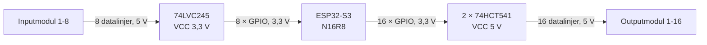

# IHC Bridge

Erstat en LK IHC-controller med en ESP32-S3 og genbrug dine eksisterende IHC-moduler.

IHC Bridge taler direkte med IHC's input- og outputmoduler og gør dem tilgængelige via MQTT, så de kan bruges i Home Assistant, Homey og andre smart home-platforme. Tryk på en IHC-knap kan styre et relæ lokalt på selve enheden, også uden netværk.

> **Status:** Firmwaren er bygget og testet på PC (unit-tests og browsertest af web-UI'et) og er ved at blive afprøvet på rigtig hardware. Tjeklisterne i [`docs/`](docs/) beskriver, hvordan den testes med IHC-moduler. Den oprindelige, testede ESPHome-version, der kun styrer outputmoduler, ligger i [`legacy/esphome/`](legacy/esphome/).

## Funktioner

- **Op til 16 outputmoduler og 8 inputmoduler:** 128 udgange og 128 indgange, hver modul på sin egen datalinje som på den originale controller.
- **Lokale regler:** et tryk på en indgang tænder en udgang, og næste tryk slukker den (kip). Reglerne kører på enheden og virker uden netværk.
- **Hurtig reaktion:** typisk ca. 67 ms fra tryk til udgangen skifter. Se [`docs/reaktionstid.md`](docs/reaktionstid.md).
- **IHC-temperaturfølere:** temperatur, luftfugtighed og gulvtemperatur. Se [`docs/temperatur.md`](docs/temperatur.md).
- **MQTT med Home Assistant-discovery:** udgange vises som lys, stikkontakter, kontakter eller ventilatorer, og indgange som tryk, dør, vindue, bevægelse eller temperatur.
- **Web-UI på dansk:** live-status, styring, navngivning, regler, indstillinger, firmwareopdatering og systemlog. Virker på telefon og computer.
- **Driftssikker:** udgangene genskabes efter strømsvigt, Wi-Fi forbindes igen af sig selv, og ny firmware rulles tilbage, hvis den ikke starter korrekt.

## Hardware

| Del | Antal | Bemærkning |
|---|---|---|
| ESP32-S3-DevKitC-1 med **N16R8** (f.eks. YD-ESP32-S3 / HW678) | 1 | 16 MB flash, 8 MB PSRAM |
| SN74HCT541N (DIP-20) | 2 | Til outputmodulerne: 3,3 V fra ESP32 → 5 V TTL. "T" i HCT er vigtigt |
| SN74LVC245N (DIP-20) | 1 | Til inputmodulerne: 5 V TTL → 3,3 V til ESP32 |
| Step-down-modul 24 V → 5 V | 1 | Forsynes fra IHC-strømforsyningen |
| Hulprint, IC-sokler, skrueterminaler | | |

> **Fælles GND er afgørende.** ESP32, alle buffer-chips, step-down-modulet og IHC-modulerne skal have fælles stel. Forbind aldrig IHC's 24 V-udgange (relæudgangene) til bufferne; kun modulernes datalinjer.



**Strøm:** IHC-strømforsyningen (24 V) → step-down-modul → 5 V til ESP32-S3 (5Vin-benet) og de to 74HCT541. 74LVC245 forsynes med 3,3 V fra ESP32-S3's 3V3-ben.

### Outputs: 2 × 74HCT541

Begge chips: pin 20 (VCC) → **5 V**, pin 10 (GND) → GND, pin 1 (OE1) og pin 19 (OE2) → GND.

| Outputmodul | ESP32-S3 | Chip | Ind (A) | Ud (Y) → modulets data |
|---|---|---|---|---|
| 1 | GPIO 1 | 1 | pin 2 (A1) | pin 18 (Y1) |
| 2 | GPIO 2 | 1 | pin 3 (A2) | pin 17 (Y2) |
| 3 | GPIO 4 | 1 | pin 4 (A3) | pin 16 (Y3) |
| 4 | GPIO 5 | 1 | pin 5 (A4) | pin 15 (Y4) |
| 5 | GPIO 6 | 1 | pin 6 (A5) | pin 14 (Y5) |
| 6 | GPIO 7 | 1 | pin 7 (A6) | pin 13 (Y6) |
| 7 | GPIO 8 | 1 | pin 8 (A7) | pin 12 (Y7) |
| 8 | GPIO 9 | 1 | pin 9 (A8) | pin 11 (Y8) |
| 9 | GPIO 10 | 2 | pin 2 (A1) | pin 18 (Y1) |
| 10 | GPIO 11 | 2 | pin 3 (A2) | pin 17 (Y2) |
| 11 | GPIO 12 | 2 | pin 4 (A3) | pin 16 (Y3) |
| 12 | GPIO 13 | 2 | pin 5 (A4) | pin 15 (Y4) |
| 13 | GPIO 14 | 2 | pin 6 (A5) | pin 14 (Y5) |
| 14 | GPIO 15 | 2 | pin 7 (A6) | pin 13 (Y6) |
| 15 | GPIO 16 | 2 | pin 8 (A7) | pin 12 (Y7) |
| 16 | GPIO 17 | 2 | pin 9 (A8) | pin 11 (Y8) |

### Inputs: 1 × 74LVC245

Pin 20 (VCC) → **3,3 V** (ESP32-S3's 3V3-ben), pin 10 (GND) → GND, pin 1 (DIR) → GND (retning B → A), pin 19 (OE) → GND.
B-siden tåler 5 V. Forbind ubrugte B-ben til GND, så de ikke svæver.

| Inputmodul | Modulets data → B | A → ESP32-S3 |
|---|---|---|
| 1 | pin 18 (B1) | pin 2 (A1) → GPIO 18 |
| 2 | pin 17 (B2) | pin 3 (A2) → GPIO 21 |
| 3 | pin 16 (B3) | pin 4 (A3) → GPIO 38 |
| 4 | pin 15 (B4) | pin 5 (A4) → GPIO 39 |
| 5 | pin 14 (B5) | pin 6 (A5) → GPIO 40 |
| 6 | pin 13 (B6) | pin 7 (A6) → GPIO 41 |
| 7 | pin 12 (B7) | pin 8 (A7) → GPIO 42 |
| 8 | pin 11 (B8) | pin 9 (A8) → GPIO 47 |

Pin-planen findes også i [`src/board_pins.h`](src/board_pins.h). Den undgår boardets strapping-ben (GPIO 0, 3, 45, 46), USB (19, 20), flash og PSRAM (26-37) og UART0 (43, 44). Den indbyggede RGB-LED på GPIO 48 bruges ikke.

## Installation

### 1. Installér firmwaren

Brug **web-installeren**: **https://k3nnis.github.io/IHC-Output-Bridge/**

Den kræver ingen programmer, kun Chrome eller Edge på en computer og et USB-C-kabel, der kan overføre data. Siden guider trin for trin: først tjekker du, at computeren kan se boardet (og installerer evt. driveren), derefter trykker du **Installér IHC Bridge**. Hele vejledningen står også i [`docs/installation.md`](docs/installation.md).

> Web-installeren udgives automatisk, når der laves et release på GitHub. Se afsnittet *For udgiveren* i [`docs/installation.md`](docs/installation.md). Indtil første release kan firmwaren flashes med PlatformIO, se [For udviklere](#for-udviklere).

### 2. Opsætning

1. Forbind telefon eller computer til Wi-Fi'et **IHC-Bridge-Opsætning** (åbent).
2. Åbn **http://192.168.4.1**.
3. Vælg dit Wi-Fi, skriv koden, og vælg en adgangskode til IHC Bridge (mindst 8 tegn). Tryk **Gem og forbind**.
4. IHC Bridge forbinder nu selv til dit Wi-Fi. Skift telefonen eller computeren tilbage til dit eget Wi-Fi, og åbn **http://ihc-bridge.local**. Der logger du ind og kan se enhedens IP-adresse.

Opsætnings-Wi-Fi'et lukker et minut efter, at enheden er på dit netværk. Er Wi-Fi-koden forkert, forbliver det åbent, så du kan rette den.

### 3. Moduler, navne og regler

- **Moduler og navne:** vælg de tilsluttede outputmoduler. Inputmoduler dukker op af sig selv, når de sender. Giv kanalerne navne og typer.
- **Regler:** vælg, hvilken indgang der skal skifte hvilken udgang.
- **Wi-Fi og MQTT:** udfyld din MQTT-broker, f.eks. Mosquitto i Home Assistant.

## Sådan finder du IHC Bridge på netværket

- **http://ihc-bridge.local** virker på Windows 10/11, Mac, iPhone, iPad og de fleste Android-telefoner (mDNS). Gem den som bogmærke.
- Under *Indstillinger* i web-UI'et står enhedens IP-adresse, f.eks. `http://192.168.1.50/`. Den virker altid, men kan skifte, medmindre du vælger en fast IP-adresse under *Wi-Fi og MQTT*.
- I routerens liste over tilsluttede enheder hedder den **ihc-bridge**.
- Den serielle log (USB) skriver begge adresser ved opstart.

Har du flere IHC Bridges, så giv dem hvert sit værtsnavn under *Wi-Fi og MQTT*, f.eks. `ihc-stue`; adressen bliver så `http://ihc-stue.local`.

## Glemt adgangskode

Hold **BOOT**-knappen på boardet inde i **10 sekunder**, mens enheden kører. Adgangskoden slettes, og næste gang du åbner web-UI'et, vælger du en ny. Wi-Fi, MQTT, navne og regler bevares.

Hold *ikke* BOOT inde, mens strømmen tilsluttes. Så starter ESP32'en i flash-tilstand i stedet.

## Mister enheden Wi-Fi?

De lokale regler og udgangene virker videre. Enheden prøver at forbinde igen med det samme, efter 5, 15, 30 og 60 sekunder og derefter hvert 10. minut. Efter 10 minutter uden forbindelse åbner den Wi-Fi'et **IHC-Bridge-Nødbetjening** (beskyttet med din adgangskode), hvor web-UI'et findes på http://192.168.4.1.

## MQTT og Home Assistant

| Topic | Indhold |
|---|---|
| `ihc/ihc-bridge/status` | `online` / `offline` |
| `ihc/ihc-bridge/output/2/2/state` | `ON` / `OFF` |
| `ihc/ihc-bridge/output/2/2/set` | send `ON`, `OFF` eller `TOGGLE` |
| `ihc/ihc-bridge/input/3/15/state` | `ON` / `OFF` |
| `ihc/ihc-bridge/input/3/status` | `online` / `offline` for inputmodul 3 |
| `ihc/ihc-bridge/temp/1/7/temperature` | `21.5` (og `humidity`, `floor`, `status`) |

Basis-topic, payloads og alle andre MQTT-indstillinger kan ændres i web-UI'et. Med Home Assistant-discovery slået til dukker enheden **IHC Bridge** op af sig selv under *Indstillinger → Enheder og tjenester → MQTT*. Andre platforme, f.eks. Homey med MQTT Hub, bruger de samme topics.

## Firmwareopdatering

1. Hent filen, der ender på **-ota.bin**, under [seneste version på GitHub](https://github.com/K3nnis/IHC-Output-Bridge/releases/latest).
2. Åbn **Firmware** i web-UI'et, vælg filen, og tryk **Opdatér firmware**.

Udgangene beholder deres tilstand. Går den nye firmware ned inden for det første minut, starter enheden igen med den forrige.

## Sikkerhedskopi

Under **Indstillinger** kan moduler, navne, typer, regler og MQTT-indstillinger gemmes i en fil og indlæses igen. Koder og Wi-Fi er ikke med i filen.

## For udviklere

### Byg og flash med PlatformIO

1. Installér [Visual Studio Code](https://code.visualstudio.com/) og udvidelsen **PlatformIO IDE**.
2. Hent koden til en kort sti uden mellemrum og uden æ, ø og å (f.eks. `C:\ihc-bridge`), og åbn mappen i VS Code. PlatformIO henter selv værktøjerne første gang.
3. Tjek at computeren kan se boardet (se [trin 1 i installationsvejledningen](docs/installation.md#trin-1-tjek-at-computeren-kan-se-boardet)).
4. Åbn en PlatformIO-terminal (myre-ikonet → **Miscellaneous → New Terminal**), og flash (ret COM-nummeret):
   ```bash
   pio run -e esp32s3 -t upload --upload-port COM8
   ```
   Hænger den på `Connecting...`: hold **BOOT**, tryk kort på **RST**, slip **BOOT**, og prøv igen.
5. Se loggen:
   ```bash
   pio device monitor -e esp32s3 --port COM8
   ```

### Værktøjer

| Kommando | Hvad |
|---|---|
| `pio test -e native` | Unit-tests på PC (bus, regler, reaktionstid, Wi-Fi, MQTT, sessioner, temperatur) |
| `pio run -e esp32s3` | Byg firmwaren |
| `tools/check_isr_iram.sh` | Tjek at hele bus-interruptet ligger i intern RAM |
| `pio run -e esp32s3_bustest -t upload` | Testfirmware til logic analyzer (skifter udgange!) |
| `python3 tools/ui_test/mock_api.py web/index.html 1` | Prøv web-UI'et uden board, se [`tools/ui_test/`](tools/ui_test/) |
| `python3 tools/lav_installer.py --version 2.0.0` | Byg web-installeren lokalt (efter `pio run -e esp32s3`) |

Opbygning:

| Mappe | Indhold |
|---|---|
| `lib/ihc/` | IHC-protokollen: Sender, Modtager, regler, Styring og temperaturafkodning (testbar på PC) |
| `lib/netvaerk/` | Wi-Fi-logik, MQTT-topics, discovery og sessioner (testbar på PC) |
| `src/` | Firmware: bus-interrupt, lagring, Wi-Fi, MQTT, webserver, sikkerhed |
| `web/index.html` | Web-UI'et; pakkes automatisk ind i firmwaren ved build |
| `installer/index.html` | Web-installerens side (GitHub Pages) |
| `.github/workflows/` | Automatisk test, build, release og web-installer |
| `test/` | Unit-tests |
| `docs/` | API, reaktionstid, temperaturprotokol og testtjeklister |
| `legacy/esphome/` | Den oprindelige ESPHome-version |

Bus-interruptet kører på kerne 1 hvert 39 µs og sender til alle 16 outputmoduler samtidig, læser alle 8 inputmoduler og udfører reglerne. Wi-Fi, MQTT og web kører på kerne 0 og kan ikke forstyrre timingen.

Dokumentation:

- [Installation](docs/installation.md)
- [Web-API](docs/api.md)
- [Reaktionstid](docs/reaktionstid.md)
- [Temperaturfølere](docs/temperatur.md)
- [Test af bussen med logic analyzer](docs/test-fase2-bus.md)
- [Test af MQTT og Home Assistant](docs/test-fase5-mqtt.md)
- [Test af opsætning, login og firmwareopdatering](docs/test-fase6-web.md)

## ESPHome-versionen

Den oprindelige ESPHome-firmware til ESP32-WROOM, der kun styrer outputmoduler, ligger uændret i [`legacy/esphome/`](legacy/esphome/) med sin egen [vejledning](legacy/esphome/README.md). Den kan stadig bygges og bruges.

## Licens

GNU General Public License v3.0. Se [LICENSE](LICENSE).
